

# Gario

**Gestão de garantias a partir de planilhas, sem abrir mão das planilhas.**

Projeto independente, idealizado e desenvolvido por **[Allan De Melo Correa](https://www.contatoallancorrea.com.br/)**.

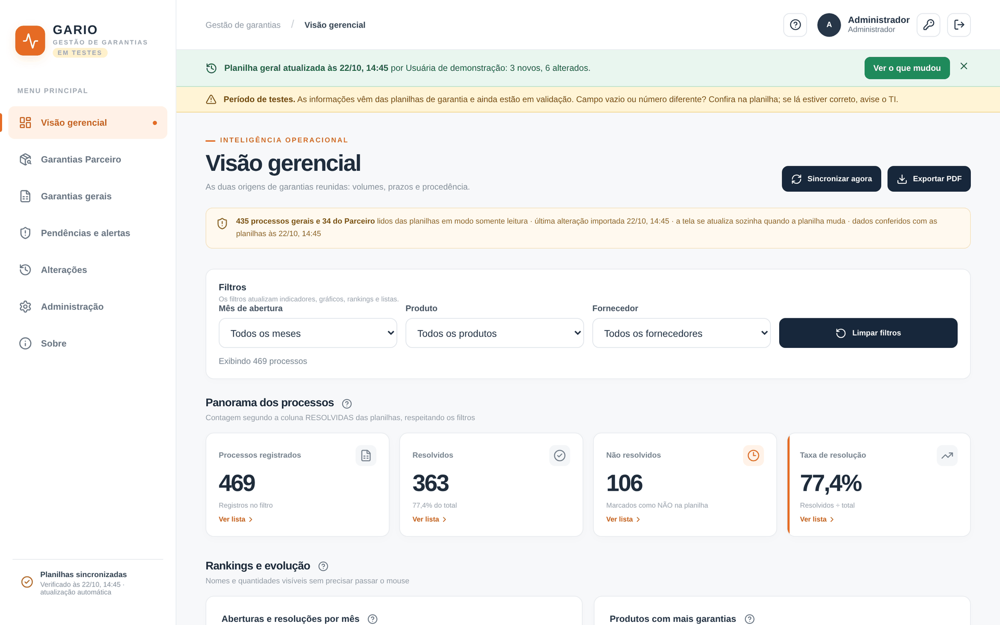

> **Sobre este repositório.** Aqui estão a documentação e as imagens do Gario. O código-fonte é privado, porque o sistema é usado em produção por uma empresa. **Todas as imagens foram geradas com dados fictícios**: lojas, fornecedores, produtos, processos e pessoas são inventados.

---

## Sumário

**Nesta página**

- [O problema](#o-problema)
- [A solução](#a-solução)
- [Do salvamento na planilha até a tela](#do-salvamento-na-planilha-até-a-tela)
- [Principais recursos](#principais-recursos)
- [Galeria](#galeria)
- [Arquitetura em uma imagem](#arquitetura-em-uma-imagem)
- [Tecnologias](#tecnologias)
- [Segurança em resumo](#segurança-em-resumo)
- [Documentação detalhada](#documentação-detalhada)
- [Autor](#autor)

**Páginas da documentação**

1. [Funcionalidades](docs/funcionalidades.md): cada tela, com imagem e explicação
2. [Arquitetura](docs/arquitetura.md): containers e fluxos de sincronização, login e consulta
3. [Stack](docs/stack.md): cada tecnologia e por que foi escolhida
4. [Código e dados](docs/codigo-e-dados.md): organização do código, modelo de dados e rotas
5. [Dados e sincronização](docs/dados-e-sincronizacao.md): regras de leitura, validação, alterações e backups
6. [Métricas](docs/metricas.md): como cada número é calculado
7. [Segurança](docs/seguranca.md): todas as camadas de proteção
8. [Operação](docs/operacao.md): atualização, homologação, planilha renomeada e problemas comuns

---

## O problema

O controle de garantias de uma rede de lojas vivia em planilhas compartilhadas no Google Drive: uma planilha geral, com uma aba por mês, e outra de um fornecedor parceiro, com etapas próprias (aprovação interna, RMA, nota fiscal, coleta e retorno da peça).

As planilhas funcionam bem para registrar, mas não respondem rápido às perguntas do dia a dia:

- O que está parado há mais de 60 ou 90 dias?
- Quais lojas e fornecedores acumulam pendências e quem mais demora para dar retorno?
- O que mudou desde ontem, e quem mudou?
- Como cada loja vê só os seus processos, sem acesso ao resto?

## A solução

O Gario **lê as planilhas que a equipe já usa, sem alterar nada nelas**, valida cada leitura, guarda o histórico num banco próprio e transforma tudo em um painel web com indicadores, prazos, alertas e listas detalhadas. Cada pessoa entra com o próprio login e vê apenas as lojas liberadas para ela.

A rotina de quem preenche a planilha não muda. **A planilha continua sendo a fonte da verdade.**

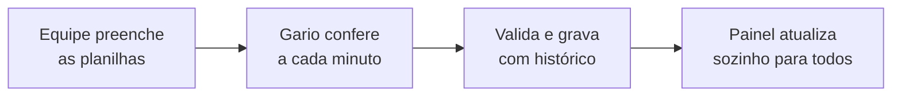

## Do salvamento na planilha até a tela

Do momento em que alguém salva a planilha até o número mudar na tela de todos, passam **no máximo cerca de 80 segundos**:

| Momento | O que acontece |
|---|---|
| 0 s | Alguém do setor salva a planilha no Google Drive |
| até 60 s | O sincronizador faz a checagem do minuto e percebe que o arquivo mudou |
| + poucos segundos | Baixa uma cópia, valida, grava no banco numa única transação e registra o que mudou e quem salvou |
| + até 20 s | A tela, que consulta a versão dos dados a cada 20 s, percebe a versão nova e recarrega sozinha |
| na hora | Aparecem o aviso de atualização no topo e o selo **Mudou** ao lado de cada processo alterado |

Se a planilha chegar incompleta (aba vazia, coluna faltando, queda grande no total), a leitura é cancelada e o banco continua intacto.

## Principais recursos

| Recurso | O que entrega |
|---|---|
| **Sincronização automática** | Confere as planilhas a cada minuto e só importa quando o arquivo mudou. A tela de quem está usando se atualiza sozinha. |
| **Somente leitura garantida** | O acesso ao Google Drive é autorizado só para leitura, e o sistema se recusa a rodar se essa permissão mudar. |
| **Proteção contra planilha incompleta** | Uma leitura cortada ou com abas vazias é bloqueada e não apaga dados. Ou entra a leitura inteira, ou nada entra. |
| **Validação contínua** | Uma segunda leitura, independente da primeira, compara a planilha com o banco linha a linha e avisa se algo não bater. |
| **Busca e filtros na lista** | A lista de processos tem busca e filtros por andamento, origem, loja, fornecedor, situação na planilha, tempo em aberto e "só os que mudaram". |
| **Selo "Mudou" no processo** | O CRM alterado nos últimos 7 dias ganha um selo; ao clicar, aparece o que mudou (valor antigo → novo), quando e quem salvou. |
| **Detalhamento com um clique** | Todo indicador, ranking, faixa de atraso e mês do gráfico abre a lista de processos daquele número, com a ficha completa de cada um. |
| **Pendências e alertas** | Prioridade por tempo em aberto, sinais de atenção, inconsistências da planilha e exportação em CSV. |
| **Maior demora de retorno** | Rankings de fornecedores, lojas e produtos que estão há mais tempo sem dar retorno. |
| **Alterações nas planilhas** | A cada atualização, mostra o que entrou, o que mudou (valor antigo → novo) e o que saiu, e quem salvou o arquivo. |
| **Data de solução** | A planilha não tinha essa informação; o Gario passou a registrar o dia em que cada processo muda para resolvido. |
| **Acesso por loja** | Login individual, perfis de administrador e operador, e restrição por loja aplicada no servidor. |
| **Avisos para todos** | Se uma leitura falhar, todos os usuários veem um aviso de que os números podem estar desatualizados. |
| **Ajuda em todo lugar** | Ícone de ajuda em cada bloco e em cada coluna, tutorial guiado no primeiro acesso, guia em linguagem simples e a aba **Instruções**, que explica como cada métrica é calculada. |
| **Celular e tablet** | Layout responsivo; no celular, as tabelas viram cartões legíveis. |
| **Backup diário** | Cópia verificada do banco todos os dias, com retenção de 7 dias. |

## Galeria

| | |
|---|---|
| 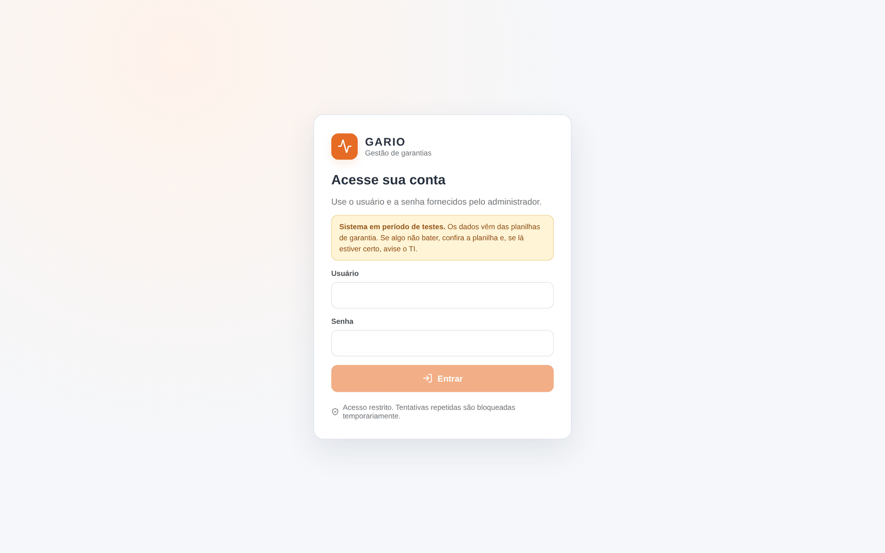 **Acesso individual** | 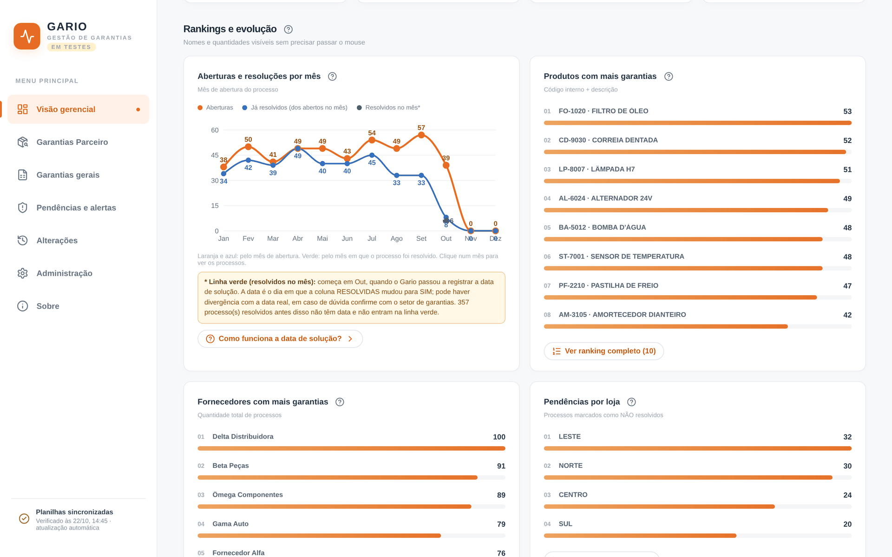 **Gráficos e rankings clicáveis** |
| 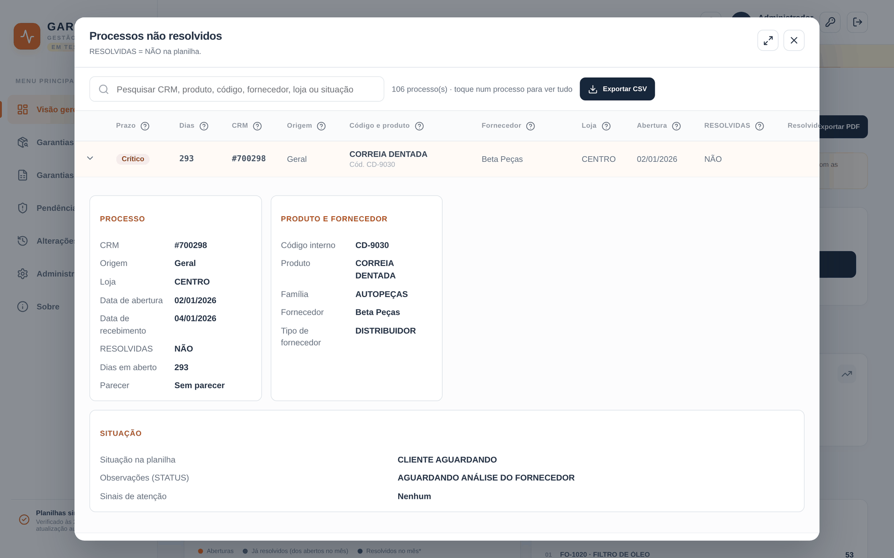 **Ficha completa do processo** | 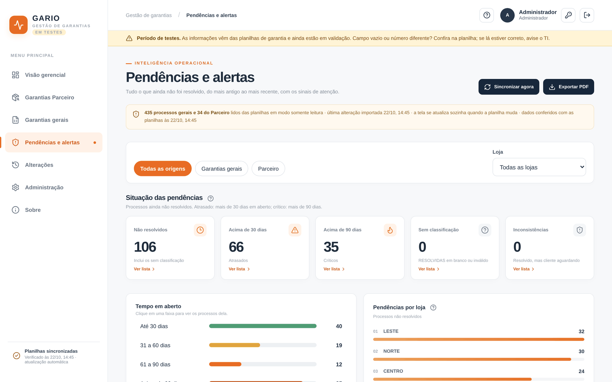 **Pendências e alertas** |
| 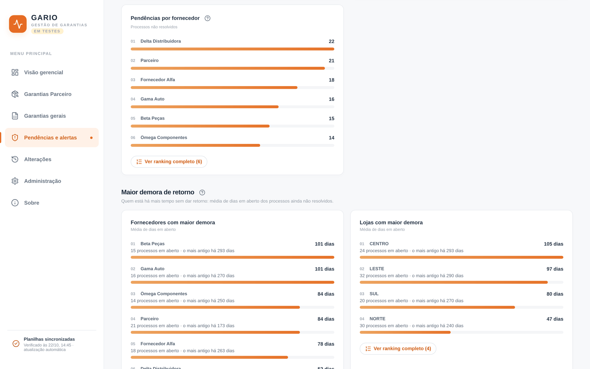 **Maior demora de retorno** | 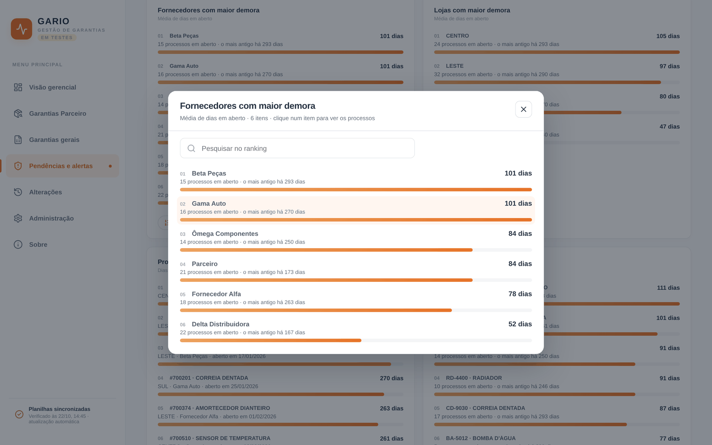 **Ranking completo com pesquisa** |
| 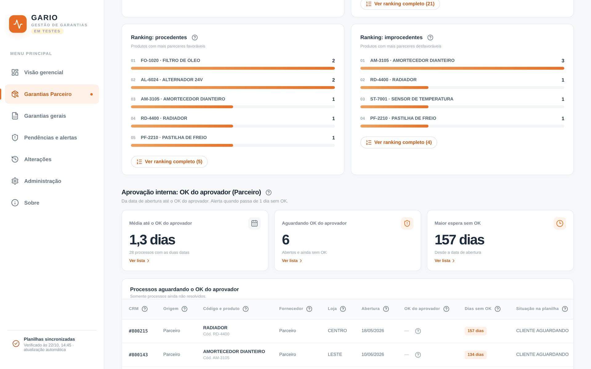 **Etapas do fornecedor parceiro** | 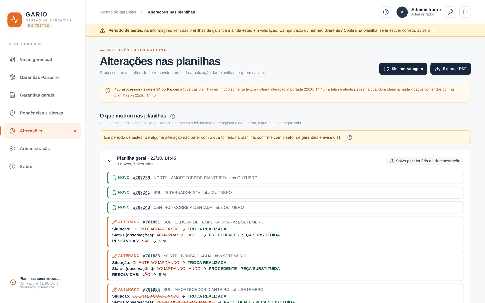 **O que mudou nas planilhas** |
| 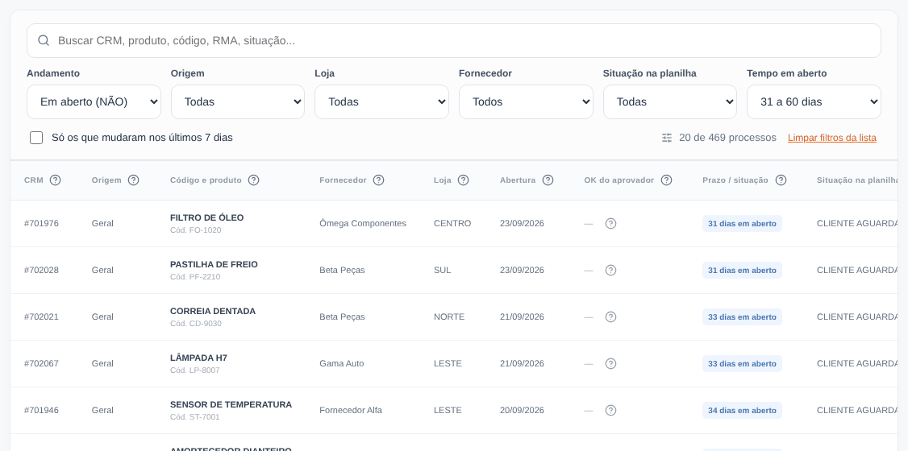 **Busca e filtros por coluna** | 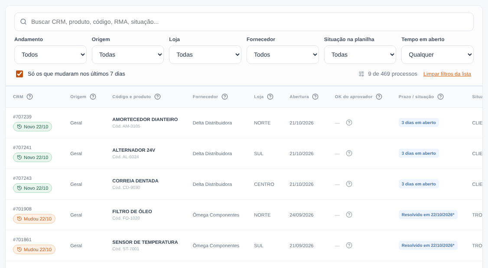 **Selo "Mudou" e "Novo" no CRM** |
| 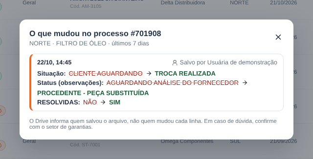 **O que mudou no processo** | 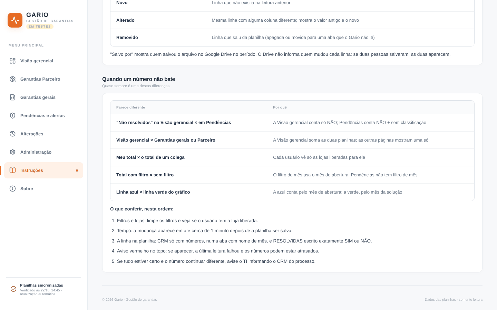 **Instruções: como cada métrica é calculada** |
| 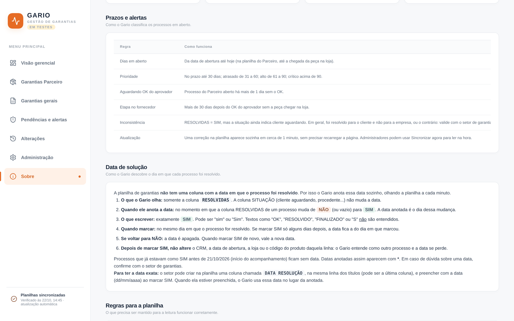 **Guia em linguagem simples** | 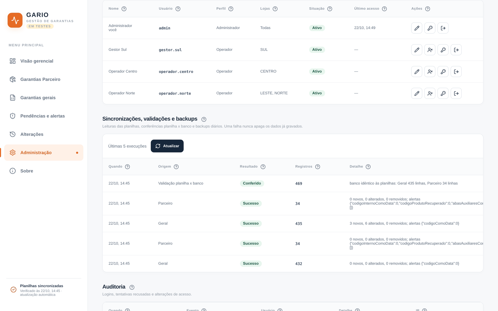 **Usuários, lojas e auditoria** |

  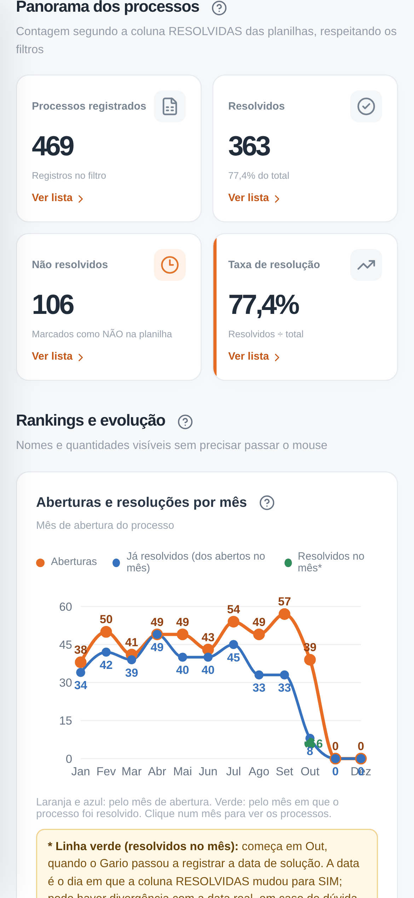
  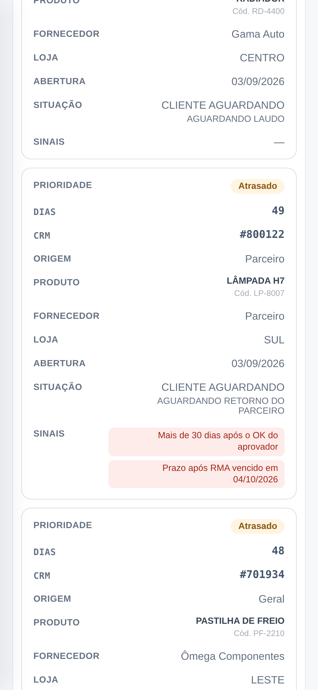
  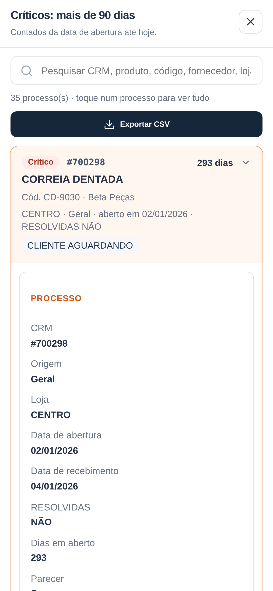

Cada tela é explicada em detalhes em [docs/funcionalidades.md](docs/funcionalidades.md).

## Arquitetura em uma imagem

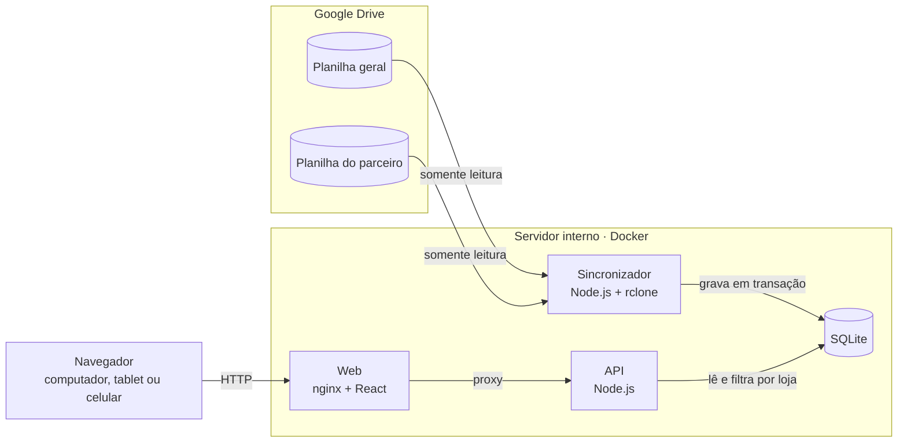

Três containers separados, cada um com uma responsabilidade:

- **Web:** o único ponto de entrada.
- **API:** login e dados, sem acesso ao Drive.
- **Sincronizador:** o único que fala com o Drive, e só para ler.

Detalhes em [docs/arquitetura.md](docs/arquitetura.md).

## Tecnologias

| Camada | Tecnologias |
|---|---|
| Interface | React 19, TypeScript, Vite, Recharts, Lucide |
| API | Node.js 22 (`node:http`, sem framework), cookies HttpOnly, scrypt |
| Dados | SQLite (better-sqlite3, modo WAL), leitura de `.xlsx` |
| Integração | rclone com Google Drive (somente leitura), API do Drive para o histórico de versões |
| Infraestrutura | Docker Compose, nginx sem privilégios, containers endurecidos |
| Qualidade | ESLint, testes de sincronização e de autenticação, validação contínua planilha × banco, roteiro de homologação |

## Segurança em resumo

- **Planilhas intocáveis:** a autorização do Drive é só de leitura, e o sistema confere isso antes de cada leitura.
- **Senhas e sessões:** senhas com hash scrypt e sessão em cookie HttpOnly e SameSite=Strict; o banco guarda só o hash do token.
- **Proteção contra ataques:** CSRF bloqueado por cabeçalho próprio e conferência de origem; bloqueio de tentativas repetidas de login.
- **Acesso por loja:** a restrição é aplicada no servidor, não só na tela.
- **Dados pessoais:** nomes de clientes não saem da API.
- **Containers:** usuários sem privilégios, sistema de arquivos somente leitura e nenhuma capacidade extra do Linux.
- **Nomes e configurações:** nomes da empresa e credenciais ficam fora do código.
- **Auditoria:** logins, tentativas recusadas e alterações de acesso ficam registrados.

Detalhes em [docs/seguranca.md](docs/seguranca.md).

## Documentação detalhada

| # | Página | Conteúdo |
|---|---|---|
| 1 | [Funcionalidades](docs/funcionalidades.md) | Cada tela, com imagem e explicação, incluindo filtros, selo "Mudou" e Instruções |
| 2 | [Arquitetura](docs/arquitetura.md) | Containers, fluxos de sincronização, login e consulta com isolamento por loja |
| 3 | [Stack](docs/stack.md) | Cada tecnologia, o papel dela no sistema e por que foi escolhida |
| 4 | [Código e dados](docs/codigo-e-dados.md) | Organização do código, modelo de dados e grupos de rotas da API |
| 5 | [Dados e sincronização](docs/dados-e-sincronizacao.md) | Regras de leitura, validação contínua, alterações, data de solução e backups |
| 6 | [Métricas](docs/metricas.md) | Como cada indicador, prioridade e alerta é calculado |
| 7 | [Segurança](docs/seguranca.md) | Todas as camadas de proteção e o roteiro de homologação |
| 8 | [Operação](docs/operacao.md) | Atualização, planilha renomeada, aba ou planilha nova e problemas comuns |

## Autor

**Allan De Melo Correa**: desenvolvedor backend, formado em Análise e Desenvolvimento de Sistemas.

Concepção, arquitetura, desenvolvimento e implantação do Gario.

[Portfólio](https://www.contatoallancorrea.com.br/) · [GitHub](https://github.com/allancorreaz)

 

---

© 2026 Allan De Melo Correa. Todos os direitos reservados. Textos e imagens deste repositório não podem ser reproduzidos sem autorização. Veja [LICENSE](LICENSE).
