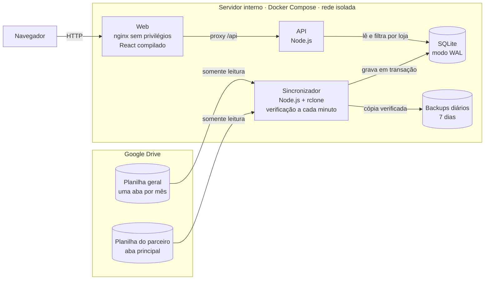
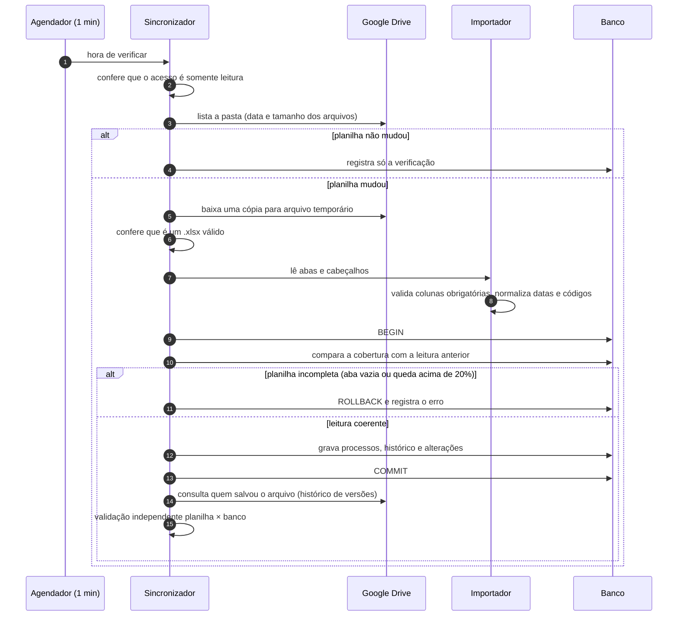
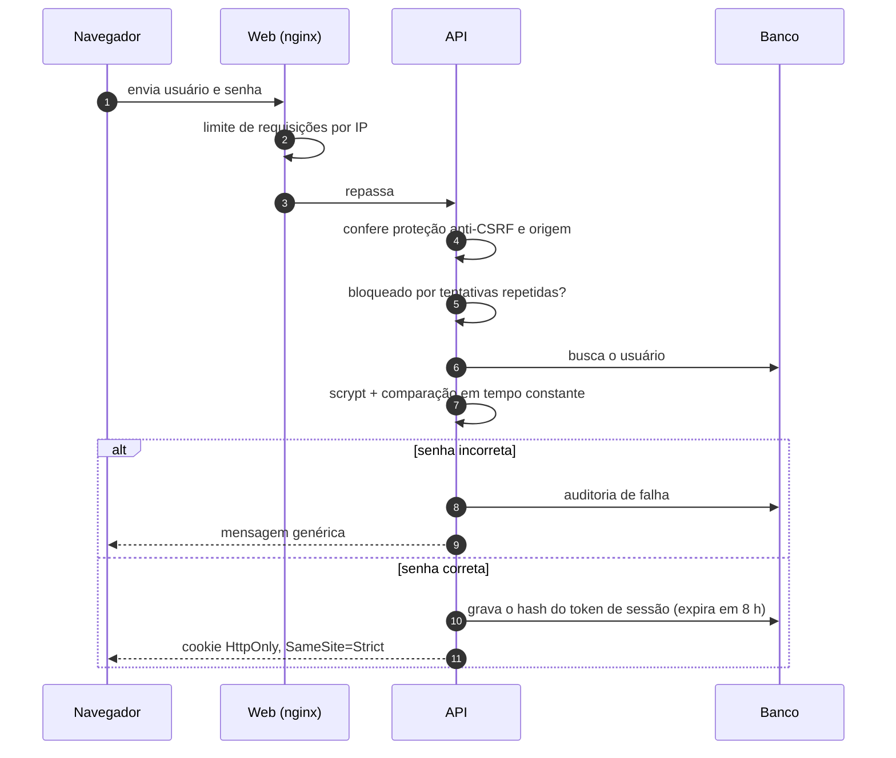
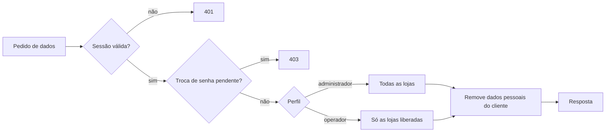

# Arquitetura

[← Voltar ao início](../README.md)

## Visão geral

| Container | Papel | Exposto na rede | Acesso ao Drive |
|---|---|---|---|
| **Web** | Serve a interface e repassa as chamadas da API | Sim, é o único | Não |
| **API** | Login, sessões, usuários, consulta das garantias | Não, só na rede interna | Não |
| **Sincronizador** | Lê as planilhas, valida, grava, confere e faz backup | Não | Sim, somente leitura |

- **Mesma imagem:** a API e o sincronizador usam a mesma imagem, com comandos diferentes.
- **Credencial do Drive:** fica apenas no sincronizador.
- **Pedido de leitura:** o botão "Sincronizar agora" não dá à API acesso ao Drive. A API grava um pedido no banco e o sincronizador atende em segundos.

## Fluxo da sincronização

- **Leitura só quando muda:** a cada minuto o sincronizador faz **uma única consulta de metadados** e só baixa o arquivo que mudou. Isso reduz o uso da API do Google e evita limites de requisição.
- **Limite de requisições:** se o Google pedir para diminuir o ritmo, a rodada é adiada por alguns minutos, sem contar como falha.
- **Tela sempre atual:** a tela consulta a cada 20 segundos uma "versão" dos dados, uma consulta leve, e só recarrega quando há importação nova.

## Fluxo de login

## Consulta com isolamento por loja

O filtro por loja é aplicado **no servidor**: um operador não consegue ver outra loja nem mexendo na URL ou na requisição. Apelidos de uma mesma loja são unificados.

## Banco de dados

| Tabela | Conteúdo |
|---|---|
| Garantias | Um registro por processo, com os dados da última leitura |
| Histórico | Cada criação ou alteração de processo |
| Alterações | O que mudou em cada leitura: novos, alterados campo a campo, removidos e quem salvou |
| Sincronizações | Execuções de leitura, validação e backup |
| Estado | Última verificação de cada planilha |
| Usuários, sessões e auditoria | Acesso ao sistema |

Nada é apagado: um processo que sai da planilha é marcado como ausente, some da tela e continua no banco com o histórico.
