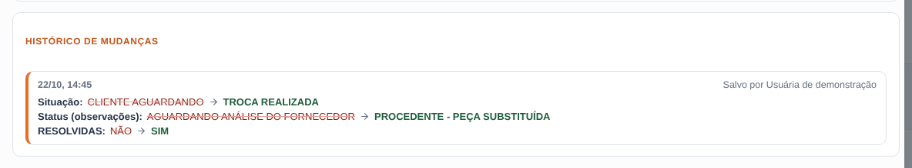
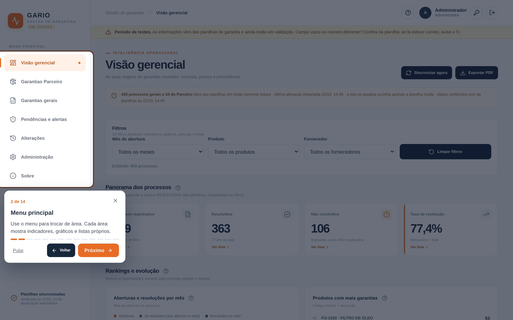

# Funcionalidades

[Início](../README.md) · [Funcionalidades](funcionalidades.md) · [Arquitetura](arquitetura.md) · [Stack](stack.md) · [Código e dados](codigo-e-dados.md) · [Dados e sincronização](dados-e-sincronizacao.md) · [Métricas](metricas.md) · [Segurança](seguranca.md) · [Operação](operacao.md) · [Versões](versoes.md)

**Nesta página:** [1. Acesso](#1-acesso) · [2. Visão gerencial](#2-visão-gerencial) · [3. Busca e filtros na lista de processos](#3-busca-e-filtros-na-lista-de-processos) · [4. Detalhamento com um clique](#4-detalhamento-com-um-clique) · [5. Pendências e alertas](#5-pendências-e-alertas) · [6. Etapas do fornecedor parceiro](#6-etapas-do-fornecedor-parceiro) · [7. Alterações nas planilhas](#7-alterações-nas-planilhas) · [8. Guia da data de solução](#8-guia-da-data-de-solução) · [9. Administração](#9-administração) · [10. Ajuda, tutorial e instruções](#10-ajuda-tutorial-e-instruções) · [11. Celular e tablet](#11-celular-e-tablet)

Todas as imagens usam **dados fictícios**.

---

## 1. Acesso

- **Contas:** cada pessoa tem login próprio, criado pelo administrador. No primeiro acesso, a troca da senha é obrigatória.
- **Tentativas de senha:** repetições seguidas bloqueiam o login temporariamente. A mensagem de erro é sempre a mesma, para não revelar se o usuário existe.
- **Fase do sistema:** o aviso de período de testes deixa claro que o sistema ainda está em homologação.

## 2. Visão gerencial

- **Indicadores:** processos registrados, resolvidos, não resolvidos e taxa de resolução, sempre respeitando os filtros por mês, produto e fornecedor.
- **Aviso de atualização:** quando alguém salva a planilha com mudanças, aparece um aviso verde para todos ("Planilha atualizada às 14:45 por Fulana: 3 novos, 6 alterados"), com o botão **Ver o que mudou**.
- **Aviso de falha:** se a leitura de uma planilha falhar, todos veem um aviso vermelho de que os números podem estar desatualizados.
- **Rastreabilidade dos processos:** a lista completa dos CRMs no fim da página, com busca e filtros por coluna (veja a seção 3).

- **Aberturas e resoluções por mês:** a linha laranja mostra quantos processos foram abertos no mês, e a azul quantos desses já estão resolvidos hoje. A linha verde (resolvidos no mês) aparece a partir do primeiro mês em que existe data de solução registrada.
- **Clique no gráfico:** abre os processos do mês em abas: abertos, já resolvidos, ainda em aberto e resolvidos naquele mês.
- **Rankings:** produtos, fornecedores, lojas, maior demora de retorno, procedentes e improcedentes. Todo item é clicável, e todo ranking tem o botão **Ver ranking completo**.

## 3. Busca e filtros na lista de processos

A lista de processos (Rastreabilidade, na Visão gerencial e nas telas de cada planilha) tem uma barra de filtros própria, que se soma aos filtros gerais de mês, produto e fornecedor:

| Filtro | Para que serve |
|---|---|
| **Busca** | Procura ao mesmo tempo em CRM, produto, código, fornecedor, loja, RMA, situação e observações. Não diferencia maiúsculas nem acentos. |
| **Andamento** | Em aberto (RESOLVIDAS = NÃO), resolvidos (SIM) ou sem classificação. |
| **Origem** | Planilha geral ou do parceiro (só na Visão gerencial, que junta as duas). |
| **Loja** e **Fornecedor** | As opções são montadas a partir dos próprios processos da lista. |
| **Situação na planilha** | Os valores exatos da coluna SITUAÇÃO, como "TROCA REALIZADA" ou "CLIENTE AGUARDANDO". |
| **Tempo em aberto** | Faixas de até 30, 31 a 60, 61 a 90 e acima de 90 dias, só para processos não resolvidos. |
| **Só os que mudaram** | Mostra apenas os processos alterados nos últimos 7 dias. |

O contador mostra quantos processos sobraram ("20 de 469 processos"), e **Limpar filtros da lista** volta tudo ao início. Os filtros combinam entre si: por exemplo, *em aberto + loja Norte + 31 a 60 dias*.

- **Exportar CSV:** baixa exatamente os processos da lista, com os filtros aplicados. Na planilha do parceiro, inclui também aprovação, RMA, prazo, nota fiscal, coleta e chegada.
- **Filtros lembrados:** cada pessoa reabre a tela com os últimos filtros que usou, separados por tela.

## 4. Detalhamento com um clique

Qualquer indicador, item de ranking, faixa de atraso ou mês do gráfico abre um painel com **todos os processos daquele número**:

- **Pesquisa e exportação:** busca por CRM, produto, código, fornecedor, loja ou situação, e exportação em CSV.
- **Ficha completa:** ao clicar num processo, mostra datas, produto, fornecedor, situação, observações, sinais de atenção e, para o fornecedor parceiro, todas as etapas.
- **Histórico de mudanças:** no fim da ficha, uma linha do tempo com tudo o que mudou naquele processo desde o início do acompanhamento, com data, quem salvou e cada coluna com o valor antigo e o novo.

- **Tamanho do painel:** abre centralizado e pode ir para tela cheia. No celular, ocupa a tela inteira e vira cartões.
- **Campo vazio:** aparece como "—" com um ícone de ajuda, que orienta a conferir a planilha e avisar o TI se lá estiver preenchido.

## 5. Pendências e alertas

Tudo o que ainda não foi resolvido, do mais antigo para o mais recente:

- **Indicadores:** não resolvidos, acima de 30 dias (atrasados), acima de 90 dias (críticos), sem classificação e inconsistências. Cada um abre a lista.
- **Tempo em aberto:** faixas clicáveis de 30, 60 e 90 dias.
- **Pendências por loja e por fornecedor.**
- **Sinais de atenção:** por exemplo, prazo após o RMA vencido, aguardando aprovação interna, mais de 30 dias no fornecedor ou resolvido com a situação ainda indicando cliente aguardando.

**Maior demora de retorno.** Média de dias em aberto dos processos não resolvidos, por fornecedor, loja e produto, além da lista dos processos há mais tempo sem retorno. Cada item mostra quantos processos estão em aberto e há quantos dias está o mais antigo.

## 6. Etapas do fornecedor parceiro

A planilha do parceiro tem um fluxo próprio. O Gario acompanha:

- **Aprovação interna:** média de dias, processos aguardando a aprovação e a maior espera.
- **Etapa no fornecedor:** do OK até a peça voltar para a loja, com alerta acima de 30 dias.
- **Acompanhamento das etapas:** RMA, prazo após o RMA, nota fiscal, coleta e chegada na loja, como estão na planilha.

## 7. Alterações nas planilhas

A cada atualização da planilha, o Gario compara com a leitura anterior e registra:

- **Novo:** processos que entraram.
- **Alterado:** cada coluna que mudou, com o valor antigo riscado e o novo em destaque.
- **Removido:** processos que saíram da planilha.
- **Quem salvou:** quem salvou o arquivo no Google Drive no período, lido do histórico de versões do arquivo.

Cada pessoa vê apenas as alterações das lojas liberadas para ela.

### Selo "Mudou" direto na lista

Não é preciso ir até a aba Alterações para saber o que mudou. Nas listas de processos, o CRM alterado nos últimos 7 dias ganha um selo laranja **Mudou 22/10**, e o processo que acabou de entrar na planilha ganha um selo verde **Novo 22/10**.

Ao clicar no selo, abre uma janela com cada mudança daquele processo: data e hora, quem salvou a planilha e cada coluna com o valor antigo riscado e o novo em destaque. O selo aparece em todas as listas: Visão gerencial, telas de cada planilha, Pendências e nos painéis que abrem ao clicar em cards e gráficos.

## 8. Guia da data de solução

A planilha não tinha uma coluna com a data em que o processo foi resolvido. O Gario passou a anotar o dia em que a coluna RESOLVIDAS muda de NÃO para SIM. A página **Sobre** explica, em linguagem simples:

- o que escrever;
- quando marcar;
- o que acontece se o processo voltar para NÃO;
- como ter a data exata, criando uma coluna própria na planilha.

As datas registradas dessa forma aparecem com um asterisco e um aviso de possível divergência.

## 9. Administração

- **Usuários:** criação com senha inicial, perfis de administrador e operador, lojas liberadas, troca de senha de qualquer usuário, desativação e encerramento de sessões.
- **Histórico de execuções:** sincronizações, validações planilha × banco e backups diários.
- **Auditoria:** logins, tentativas recusadas, trocas de senha e alterações de acesso, com data, usuário e IP.

## 10. Ajuda, tutorial e instruções

- **Tutorial guiado:** no primeiro acesso, um tour destaca cada área da tela. Ele pode ser revisto a qualquer momento.
- **Ícone de ajuda:** cada bloco e cada coluna têm um ícone que explica de onde vem a informação e como ela é calculada.

- **Aba Instruções:** explica, em linguagem simples, como cada métrica é calculada e o que conferir quando um número parece não bater. As regras completas estão em [Métricas e regras de cálculo](metricas.md).

## 11. Celular e tablet

  
  
  

No celular, o menu vira gaveta, as tabelas viram cartões com o nome de cada campo e o painel de detalhe ocupa a tela inteira. No tablet, os processos aparecem em duas colunas.
