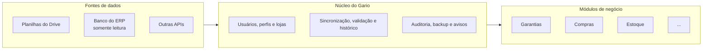

# Versões e roadmap

[Início](../README.md) · [Funcionalidades](funcionalidades.md) · [Arquitetura](arquitetura.md) · [Stack](stack.md) · [Código e dados](codigo-e-dados.md) · [Dados e sincronização](dados-e-sincronizacao.md) · [Métricas](metricas.md) · [Segurança](seguranca.md) · [Operação](operacao.md) · [Versões](versoes.md)

O Gario segue o [Versionamento Semântico](https://semver.org/lang/pt-BR/) (MAJOR.MINOR.PATCH), registra cada versão num changelog no padrão [Keep a Changelog](https://keepachangelog.com/pt-BR/1.1.0/) e usa [Conventional Commits](https://www.conventionalcommits.org/pt-br/v1.0.0/), com um assunto por commit (`feat`, `fix`, `perf`, `refactor`, `test`, `docs`, `chore`).

**Nesta página:** [Linha do tempo](#linha-do-tempo) · [1.2.0](#120--24102026) · [1.1.0](#110--24102026) · [1.0.0](#100--24102026) · [Próximas versões](#próximas-versões) · [Como uma versão é lançada](#como-uma-versão-é-lançada)

## Linha do tempo

| Versão | Tema | Situação |
|---|---|---|
| **1.0** | Garantias a partir das planilhas | Lançada em 24/10/2026 |
| **1.1** | Melhorias de uso, desempenho, testes e backup externo | Lançada em 24/10/2026 |
| **1.2** | Backup no Drive por quantidade de cópias e projeto organizado; liberada para todos | Lançada em 24/10/2026 |
| **1.3** | Avisos automáticos por e-mail e WhatsApp | Planejada |
| **2.0** | Gario Gestão: módulos e novas fontes de dados | Planejada |

## 1.2.0 · 24/10/2026

Versão liberada para uso por todos os usuários.

- **Backup no Drive por quantidade:** ficam só as cópias mais recentes (padrão: 2), e as antigas são apagadas a cada envio.
- **Projeto organizado:** testes de sincronização agrupados e scripts de uso único removidos.
- **Documentação:** para que serve a chave de criptografia do backup e o que fazer se ela for perdida ou vazar.

## 1.1.0 · 24/10/2026

**Adicionado**
- Exportar em CSV exatamente os processos da lista, com os filtros aplicados.
- Filtros da lista lembrados por usuário e por tela.
- Histórico completo de mudanças na ficha de cada processo.
- Cópia criptografada opcional do backup numa pasta do Google Drive (veja [Segurança](seguranca.md)).
- Testes automáticos das regras de prazo, dos filtros e da criptografia do backup, rodando antes de cada atualização.
- Versão do sistema no rodapé e na página Sobre.

**Melhorado**
- Telas secundárias carregadas só quando abertas e bibliotecas em arquivos próprios: a tela inicial carrega bem menos código.
- A rotina de atualização remove só as imagens antigas do próprio Gario, sem tocar em outros sistemas do servidor, e mostra o uso do disco.

## 1.0.0 · 24/10/2026

Primeira versão estável, em período de testes com os usuários: sincronização somente leitura com as planilhas, validação contínua, alterações e quem salvou, data de solução, painel com indicadores e rankings clicáveis, filtros por coluna, selo "Mudou", pendências e alertas, login próprio com acesso por loja, auditoria e backup diário.

## Próximas versões

### 1.3: avisos automáticos
- **Resumo diário por e-mail**, pelo servidor de e-mail da empresa: processos críticos, o que mudou ontem e pendências por loja.
- **WhatsApp** pela API oficial da Meta (WhatsApp Cloud API), com número próprio da empresa.
- **Alertas na hora** para processo que virou crítico, falha de leitura da planilha e divergência planilha × banco.

### 2.0: Gario Gestão

O Gario nasceu para as garantias, mas a base (login, permissões por loja, auditoria, sincronização segura, histórico, backup e painel) serve para qualquer área. A versão 2.0 organiza o sistema em módulos:

- **Fontes de dados como adaptadores:** planilha, banco do ERP ou API, todos com a mesma interface e a mesma regra de somente leitura.
- **Núcleo comum** a todos os módulos: login, perfis, lojas, auditoria, sincronização, validação, histórico, backup e avisos.
- **Módulos de negócio** com tabelas, telas, indicadores e permissões próprias. Um usuário pode ver garantias e não ver financeiro, por exemplo.

## Como uma versão é lançada

1. Cada mudança entra num commit separado, no padrão Conventional Commits.
2. Ao fechar a versão, changelog e número da versão são atualizados num commit `chore(release): X.Y.Z`, marcado com a tag `vX.Y.Z`.
3. O servidor é atualizado pela rotina de homologação, que só sobe a nova versão se todos os testes passarem.
